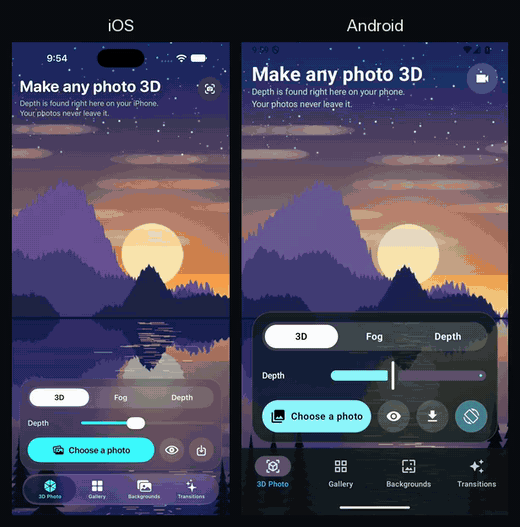
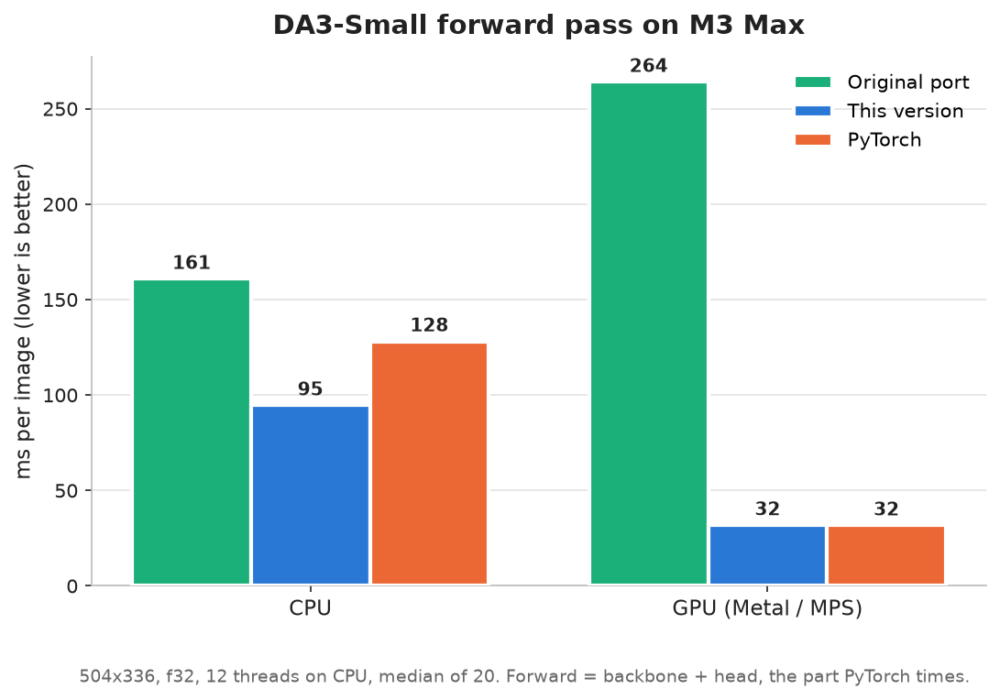
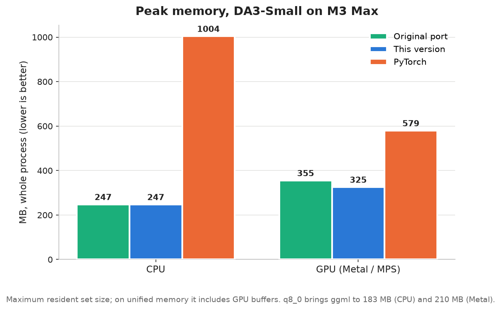
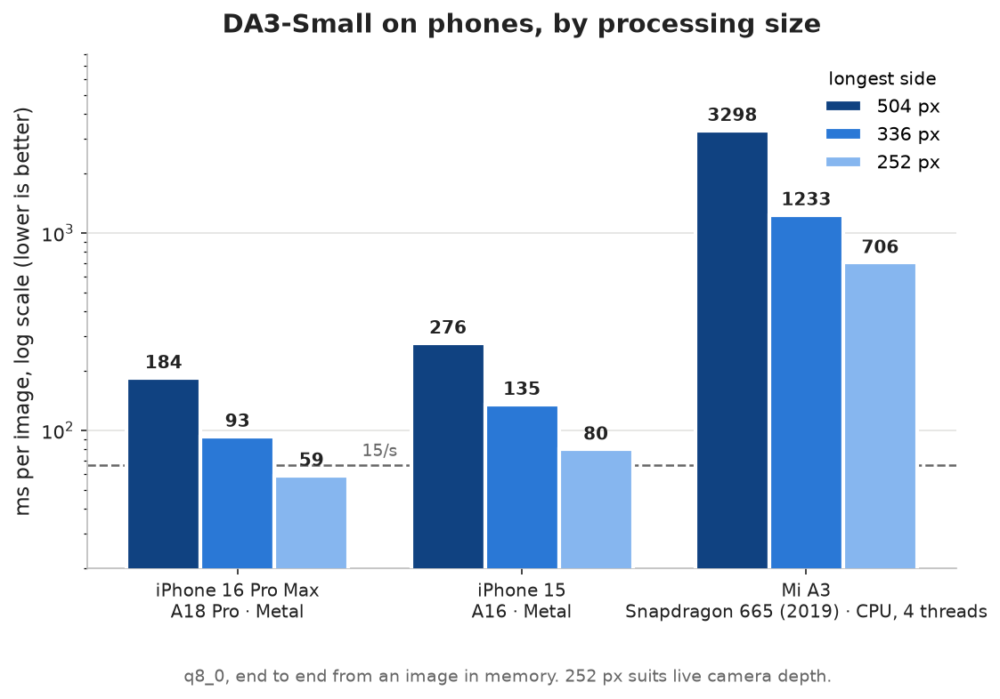
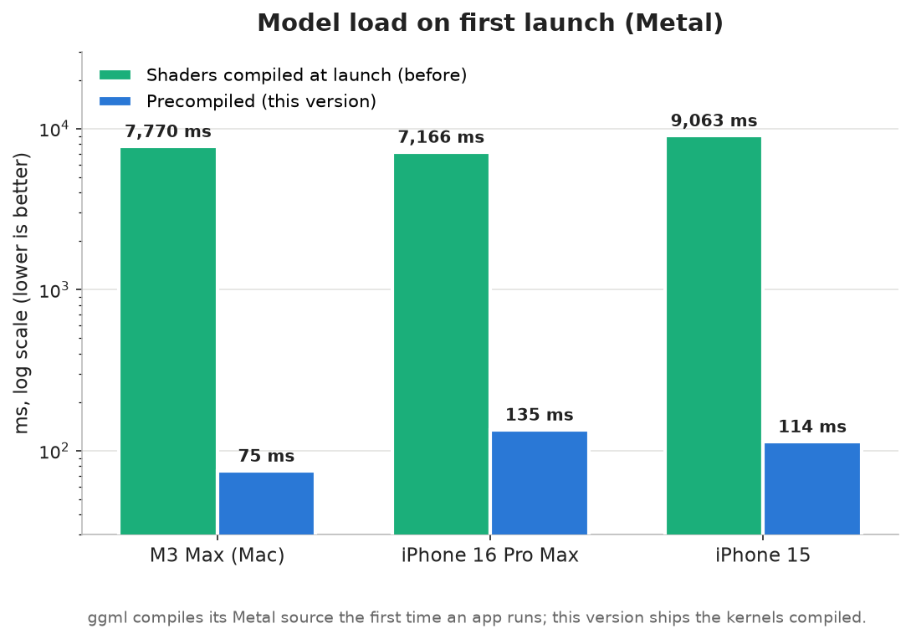
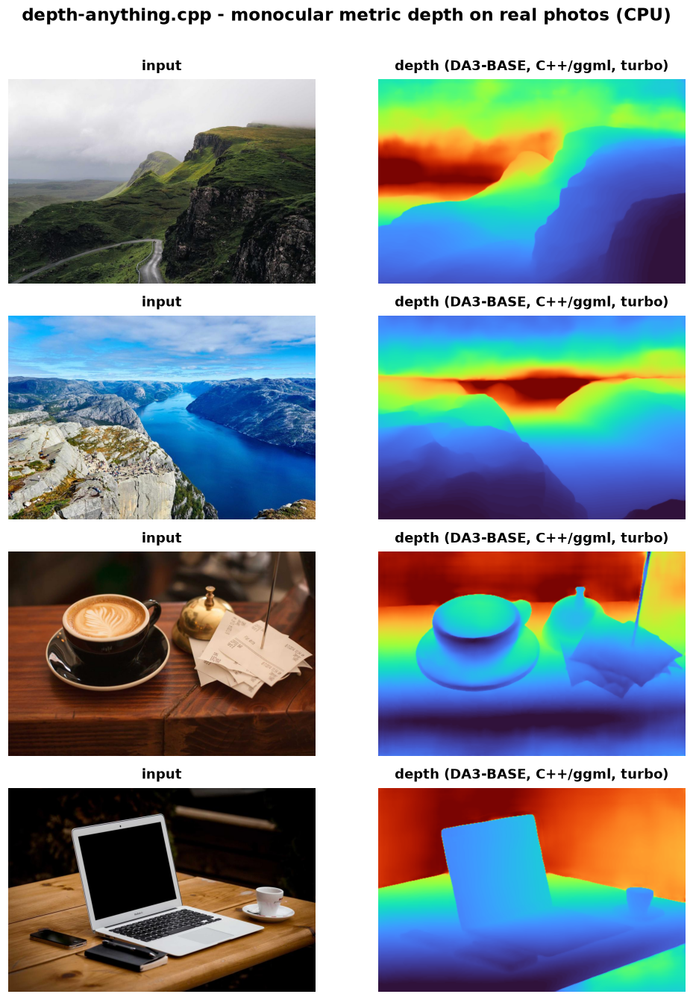

# depth-anywhere

**Depth Anything on every device.** iPhone, Android, Mac, Linux and Windows; CPU or GPU. One small C++ library,
one GGUF file, no Python.

[](LICENSE)




> Pick a photo, the phone finds its depth on device, then the photo turns 3D, fogs up with distance, or shows its
> depth map. The same engine on iOS and Android, recorded in the simulator and emulator (depth on the Mac's CPU
> there); on an iPhone 16 Pro Max it takes 184 ms. [Full quality clip](benchmarks/media/phones_showcase.mp4).

depth-anywhere runs [Depth Anything 3](https://github.com/bytedance-seed/depth-anything-3) and
[Depth Anything V2](https://github.com/DepthAnything/Depth-Anything-V2) with [ggml](https://github.com/ggml-org/ggml):
dense depth, confidence, camera pose, sky masks and 3D export from a single image, numerically equal to the
PyTorch reference, and fast enough for live camera depth on a phone.

- **On phones.** A Swift package for iOS (Metal) and a Kotlin library for Android (NDK), with an API built for
  apps: depth straight from camera frames and bitmaps, and a processing size you can lower for live video.
- **Fast on Apple GPUs.** DA3-Small in **32 ms** on an M3 Max, level with PyTorch MPS while using 44% less memory,
  and **8x faster** than the C++ port it grew from.
- **Instant first launch.** The Metal kernels ship compiled. Without that, the first launch after an install
  spends **7-9 s** compiling shaders on a phone; here the model is ready in **~0.1 s**.
- **Fast on ARM CPUs.** 1.7x faster than before and faster than PyTorch on the same Mac, from NEON kernels and a
  ggml fix that keeps its fast matmuls on CPUs with i8mm.
- **The whole model.** Depth, confidence, pose, sky, ray pose, multi-view, point clouds, and glb / COLMAP / PLY
  export, across the DA3 family and DA2, parity-checked component by component.

---

## Performance

**Apple M3 Max** (DA3-Small, 504x336, f32, 12 threads on CPU, median of 20)

 

| engine | device | quant | load ms | forward ms | end to end ms | peak RAM MB |
|--------|--------|-------|--------:|-----------:|--------------:|------------:|
| depth-anything.cpp (original) | CPU | f32 | 16 | 160.8 | 171.7 | 247 |
| **depth-anywhere** | CPU | f32 | **14** | **94.6** | **106.6** | **247** |
| PyTorch 2.15 | CPU | f32 | 409 | 128.1 | | 1004 |
| depth-anything.cpp (original) | Metal | f32 | 7770* | 264.0 | 274.6 | 355 |
| **depth-anywhere** | Metal | f32 | **75** | **31.8** | **42.3** | **325** |
| PyTorch 2.15 | MPS | f32 | 536 | 31.7 | | 579 |
| **depth-anywhere** | CPU | q8_0 | **10** | **71.4** | **82.0** | **183** |
| **depth-anywhere** | Metal | q8_0 | **62** | **31.1** | **42.2** | 210 |

*Forward* is the backbone and head, the part PyTorch's timing covers; *end to end* adds JPEG decode and
preprocessing (about 10 ms). Peak RAM is the whole process; on unified memory it includes GPU buffers.
\* First run with a cold shader cache; later runs load in ~70 ms, until the next install or OS update.

Depth Anything V2-Small (q8_0, 784x518, end to end): CPU 356 -> **243 ms**, Metal 671 -> **83 ms**. PyTorch MPS
runs it in 34 ms (forward, f32), so the DA2 graph on Metal is the next thing to optimize.

**Phones** (DA3-Small q8_0, end to end from an image in memory)

 

| device | backend | 504 px | 336 px | 252 px | first-launch load |
|--------|---------|-------:|-------:|-------:|------------------:|
| iPhone 16 Pro Max (A18 Pro) | Metal | 184 ms | 93 ms | **59 ms** | 135 ms |
| iPhone 15 (A16) | Metal | 276 ms | 135 ms | 80 ms | 114 ms |
| Mi A3 (Snapdragon 665, 2019) | CPU, 4 cores | 3298 ms | 1233 ms | 706 ms | |

252 px is the size for live camera depth: about 17 depth maps a second on an iPhone 16 Pro Max.

Method, raw numbers and scripts: [`benchmarks/BENCHMARK.md`](benchmarks/BENCHMARK.md),
[`results_apple.json`](benchmarks/results_apple.json), [`results_mobile.json`](benchmarks/results_mobile.json). It
also has the engine's x86 (Ryzen 9 9950X3D) and CUDA (NVIDIA GB10) results against PyTorch, measured by the
original authors: faster than PyTorch on x86 CPUs, level with cuDNN on CUDA.



---

## Supported models

Convert any official checkpoint to GGUF (see [Models](#models)); every dimension and preprocessing constant lives
in the file, so one engine runs them all.

| Model | Backbone | Output | Weights licence |
|-------|----------|--------|-----------------|
| `DA3-SMALL` | ViT-S | depth + confidence + pose | Apache-2.0 |
| `DA3-BASE` | ViT-B | depth + confidence + pose | Apache-2.0 |
| `DA3-LARGE` | ViT-L | depth + confidence + pose | CC BY-NC 4.0 |
| `DA3-GIANT` | ViT-g | depth + confidence + pose + 3D Gaussians | CC BY-NC 4.0 |
| `DA3MONO-LARGE` | ViT-L | depth + sky | Apache-2.0 |
| `DA3METRIC-LARGE` | ViT-L | metric depth + sky | Apache-2.0 |
| `DA3NESTED-GIANT-LARGE` | ViT-g + ViT-L | aligned metric depth + pose | CC BY-NC 4.0 |
| `Depth-Anything-V2-{Small,Base,Large}` | ViT-S/B/L | relative (inverse) depth | Small: Apache-2.0; Base/Large: CC BY-NC 4.0 |
| `Depth-Anything-V2-Metric-{Hypersim,VKITTI}-{Small,Base,Large}` | ViT-S/B/L | metric depth, indoor (20 m) / outdoor (80 m) | see each model card |

Converting to GGUF doesn't change a checkpoint's licence. The Apache-2.0 ones (DA3 Small, Base, Mono-Large and
Metric-Large, DA2 Small) can go in a commercial app; check the
[official model cards](https://github.com/ByteDance-Seed/Depth-Anything-3) before distributing any of them.

---

## Build

```sh
git clone --recursive https://github.com/MaTriXy/depth-anywhere
cd depth-anywhere
cmake -B build                      # add -DDA_GGML_METAL=ON (Apple), -DDA_GGML_CUDA=ON or -DDA_GGML_VULKAN=ON
cmake --build build -j
# -> build/examples/cli/da3-cli
```

| option | default | what it does |
|--------|---------|--------------|
| `DA_BUILD_CLI` | ON | the `da3-cli` tool |
| `DA_BUILD_TESTS` | OFF | the ctest parity suite |
| `DA_SHARED` | OFF | `libdepthanything` as a shared library, for embedding |
| `DA_GGML_METAL` / `DA_GGML_CUDA` / `DA_GGML_VULKAN` | OFF | GPU backends ([`docs/GPU.md`](docs/GPU.md)) |
| `DA_GGML_LLAMAFILE` | ON | tinyBLAS matmul kernels on CPU |
| `DA_GGML_PATCHES` | ON | applies [`patches/ggml/`](patches/ggml) to the ggml submodule at configure time |
| `DA_METAL_PRECOMPILED` | ON | Apple: embeds ggml's Metal kernels compiled for the target SDK (~7.6 MB, ~2 MB compressed) |
| `DA_ARM_KEEP_LLAMAFILE` | ON | arm64: keeps ggml's NEON sgemm when the CPU has i8mm |

For iOS and Android, see [In your app](#in-your-app).

## Models

Ready-made GGUFs (the same format, converted by the original authors) download with
`scripts/fetch_models.sh`, or straight from
[Hugging Face](https://huggingface.co/mudler/depth-anything.cpp-gguf). To convert your own (needs Python; inference
doesn't):

```sh
python3 -m venv .venv && source .venv/bin/activate && pip install -r requirements.txt
python scripts/download_model.py --repo depth-anything/DA3-SMALL --out models/DA3-SMALL
python scripts/convert_da3_to_gguf.py --model models/DA3-SMALL --output models/depth-anything-small-f32.gguf
build/examples/cli/da3-cli quantize models/depth-anything-small-f32.gguf models/depth-anything-small-q8_0.gguf q8_0
```

Quantization types: `f16`, `q8_0` (near-lossless, the one to ship on phones), `q6_k`, `q5_k`, `q4_k`. Other
converters: `convert_mono_to_gguf.py` (DA3MONO), `convert_nested_to_gguf.py` (DA3NESTED), and
`convert_da2_to_gguf.py --encoder vits|vitb|vitl --ckpt <.pth> [--max-depth 20|80]` (DA2, relative or metric).

## Command line

```sh
CLI=build/examples/cli/da3-cli
M=models/depth-anything-small-q8_0.gguf

$CLI depth --model $M --input photo.jpg --pfm depth.pfm --png depth.png        # depth (float PFM + PNG)
$CLI depth --model $M --input photo.jpg --pose pose.json                       # + camera pose
$CLI depth --model $M --input photo.jpg --glb scene.glb --colmap colmap/       # 3D export
$CLI depth --model $M --input a.jpg --input b.jpg --out-prefix scene           # multi-view
$CLI depth --model models/depth-anything-mono-large-f32.gguf --input photo.jpg --sky sky.pfm
$CLI depth --model nested-anyview.gguf --metric-model nested-metric.gguf --input photo.jpg --pfm metric.pfm
$CLI reconstruct --model models/depth-anything-giant-f32.gguf --input photo.jpg --ply cloud.ply
$CLI info --model $M                                                           # what's in the GGUF
$CLI depth --model $M --input photo.jpg --repeat 20                            # benchmark
```

The glb and COLMAP writers have no dependencies; see [`docs/EXPORT.md`](docs/EXPORT.md). `DA_PROFILE=1` prints the
preprocess / graph split, `DA_PROFILE_OPS=1` the time per ggml op.

---

## In your app

**iOS and macOS.** `scripts/build-apple.sh` builds `DepthAnything.xcframework` (iPhone, simulator and Mac slices,
Metal) into `bindings/apple`, a Swift package:

```swift
import DepthAnything

let estimator = try DepthEstimator(modelURL: url)   // threads: 0 picks the performance cores
estimator.processingSize = 252                      // live video; nil restores 504
let depth = try estimator.depth(from: pixelBuffer)  // a camera frame (32BGRA), or from: CGImage
let map = depth.nearnessImage()                     // 8-bit, brighter is nearer
```

In the iOS Simulator it runs on the CPU (the simulator's Metal driver can't map the host buffers ggml uses).

**Android.** `bindings/android` is a library module (NDK, arm64-v8a, minSdk 26):

```kotlin
DepthEstimator(modelFile.path).use { estimator ->   // copy the GGUF out of assets to a file first
    estimator.processingSize = 252
    val depth = estimator.depth(bitmap)
    val map = depth.nearnessBitmap()
}
```

For live video, `DepthMap.nearnessRange()` and `nearness(range:)` let you smooth the contrast range between frames
instead of restretching every map on its own.

**C API** (`include/da_capi.h`), which both wrap:

```c
da_ctx* ctx = da_capi_load("model.gguf", /*threads, 0 = auto*/ 0);
da_capi_set_resize_target(ctx, 252);   // longest side; 0 restores the model's own

// Pixels from memory: RGB/RGBA/BGRA, any row stride (CVPixelBuffer, Android Bitmap)
int h, w;
float* depth = da_capi_depth_pixels(ctx, pixels, width, height, stride, /*channels*/ 4, /*bgr*/ 1, &h, &w);
int kind = da_capi_output_kind(ctx);   // 0 depth, 1 inverse depth, 2 metric metres
da_capi_free_floats(depth);

// The full output from a file: depth, confidence, sky, extrinsics (3x4), intrinsics (3x3)
float *d, *conf, *sky, ext[12], intr[9]; int is_metric;
da_capi_depth_dense(ctx, "photo.jpg", &h, &w, &d, &conf, &sky, ext, intr, &is_metric);
da_capi_export_glb(ctx, "photo.jpg", "scene.glb");
da_capi_free(ctx);
```

Opaque handles, C types only, `da_capi_last_error` for diagnostics; build with `-DDA_SHARED=ON` to embed it from
C, C++, Go, Rust or Swift.

**DA3 studio.** [`server/`](server) is a browser demo that turns photos and videos into a 3D point cloud (or 3D
Gaussians with DA3-Giant), rendered live in a WebGL viewer.

---

## How it's fast

- **Metal.** The DPT head's transposed convolutions (kernel == stride) run as one matmul plus a depth-to-space
  shuffle instead of ggml's generic kernel, about 240 ms of the original's Metal time at 504x336. ggml's Metal im2col
  runs one thread per output element instead of one threadgroup per pixel (a single thread for a 1x1 conv), which
  took it from about half the remaining time to a few percent.
- **First launch.** ggml compiles its Metal source when an app first starts. The build compiles the kernels for the
  target SDK and embeds the metallib; GPUs that need other kernel features (the Metal 4 tensor API on M5/A19, or no
  bfloat) still compile the source.
- **ARM CPUs.** ggml disables its tinyBLAS matmuls whenever the compiler targets i8mm (Apple M2+, recent phones),
  making every matmul ~3x slower; the build masks that macro for ggml-cpu. NEON Winograd F(2x2) for 3x3
  convolutions, a NEON 1x1 convolution kernel, a NEON GELU, and a thread count that uses the performance cores.
- **x86 and CUDA.** Cached positional embeddings, tinyBLAS, Winograd and fused flash attention.

The ggml changes are small patches in [`patches/ggml/`](patches/ggml), applied to the submodule at configure time;
they pass ggml's own `test-backend-ops`.

## Parity and tests

Every component is checked against tensors dumped from the PyTorch reference: preprocessing, backbone, attention,
DPT head, depth, pose, ray head, the ray-to-pose solver, the exporters and the C API. End-to-end depth correlates
1.0 with the real DA3 forward. CPU output is bit-exact with the original C++ port; Metal matches to float rounding
(correlation 0.99999). Details in [`docs/VERIFICATION.md`](docs/VERIFICATION.md).

```sh
cmake -B build -DDA_BUILD_TESTS=ON && cmake --build build -j && ctest --test-dir build
```

Most suites need the reference dumps and the larger models (`scripts/dump_*.py`, `scripts/fetch_models.sh`).

---

## Credits

depth-anywhere grew out of [depth-anything.cpp](https://github.com/mudler/depth-anything.cpp) by Ettore Di Giacinto
and Richard Palethorpe (MIT), whose from-scratch, parity-checked ggml port of Depth Anything 3 is the engine this
builds on. Depth Anything 3 is by [ByteDance Seed](https://github.com/bytedance-seed/depth-anything-3), Depth
Anything V2 by its [authors](https://github.com/DepthAnything/Depth-Anything-V2), and the tensor library is
[ggml](https://github.com/ggml-org/ggml).

If you use the model, please cite Depth Anything 3:

```bibtex
@article{depthanything3,
  title   = {Depth Anything 3: Recovering the visual space from any views},
  author  = {Haotong Lin and Sili Chen and Jun Hao Liew and Donny Y. Chen and Zhenyu Li and Guang Shi and Jiashi Feng and Bingyi Kang},
  journal = {arXiv preprint arXiv:2511.10647},
  year    = {2025}
}
```

## License

The code is [MIT](LICENSE). Model weights keep the licence of their original checkpoint (see
[Supported models](#supported-models)).
